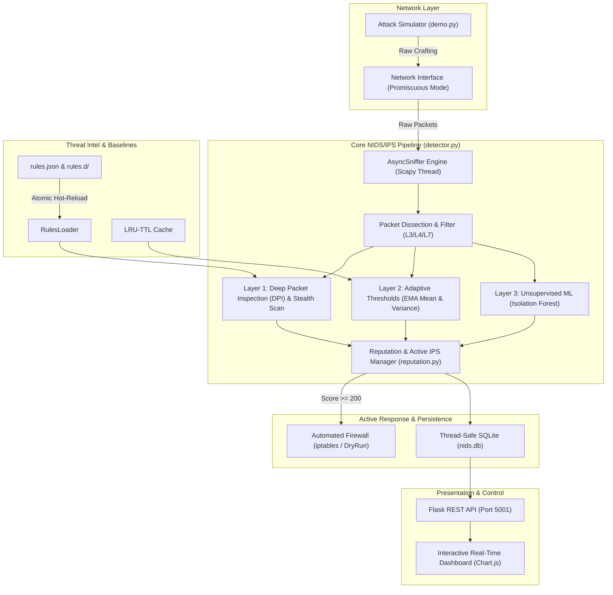

# HYBRID NETWORK INTRUSION DETECTION & PREVENTION SYSTEM (NIDS / NIPS)
## Comprehensive Project Documentation & Slide-by-Slide Presentation Blueprint

> **Course:** Computer Networks (Sem 5) — Department of Computer Science & Engineering, VIT  
> **Tech Stack:** Python 3, Scapy (Raw Sockets / `AsyncSniffer`), Flask, Scikit-Learn (`IsolationForest`), SQLite, Chart.js, Linux `iptables`  
> **Key Architecture:** 4-Tier Hybrid Engine (L7 Deep Packet Inspection, Adaptive Statistical Baselines, Unsupervised ML Anomaly Detection, Active IPS Reputation Mitigation)

---

## Executive Summary & Presentation Strategy

This document provides a complete, structured presentation blueprint for the **Network Intrusion Detection & Prevention System (NIDS/IPS)**. It contains:

1. **Slide-by-Slide Deck Outline (17 Slides):** Fully scripted slide layouts, bullet points, presenter notes, diagrams, and UI screenshots suggestions.
2. **Technical Deep-Dive Reference:** Mathematical models, algorithm logic, protocol header mechanics, and concurrency architecture for answering examiner questions.
3. **Live Demonstration Playbook:** Step-by-step commands to demonstrate real-time detection of 6 distinct attack vectors and live automated firewall blocking.
4. **Viva & Examiner Defense Q&A:** Top 10 anticipated questions with comprehensive technical answers.

---

# SECTION 1: SLIDE-BY-SLIDE PRESENTATION BLUEPRINT

---

### SLIDE 1: Title & Project Overview

#### Slide Layout:
* **Style:** Minimalist, high-contrast cybersecurity theme (Dark slate / deep navy background with emerald or cyan accents).
* **Header / Title:** **Autonomous Multi-Layered Network Intrusion Detection & Prevention System (NIDS / NIPS)**
* **Subtitle:** *Real-Time Deep Packet Inspection, Adaptive Statistical Baselines, Unsupervised Machine Learning & Automated Active Mitigation*
* **Metadata Box:**
  * Course: Computer Networks (CSE3002 / Sem 5)
  * Institution: Vellore Institute of Technology (VIT)
  * Presenter / Team Members: Team 1
  * Technologies: Python • Scapy • Flask • Scikit-Learn • SQLite • iptables

#### Key Bullet Points on Slide:
* **End-to-End Network Security:** Bridges passive packet capture with active intrusion prevention.
* **4-Tier Defense Architecture:** Decoupled Threat Intelligence, Adaptive Volumetric Baselines, ML Anomaly Detection, and Dynamic Reputation Scoring.
* **Production-Grade Design:** Zero-downtime hot-reloadable rules, asynchronous multi-threading, and non-blocking web telemetry.

#### Speaker Notes (What to say):
> *"Good morning/afternoon respected professors and evaluators. Today, we are presenting our Computer Networks project: an Autonomous, Multi-Layered Network Intrusion Detection and Prevention System. Modern computer networks face threats ranging from low-layer volumetric floods and stealth port reconnaissance to high-layer zero-day exploits and web injection attacks. Traditional systems typically rely either strictly on static signatures or solely on statistical models. Our system integrates both paradigms into a unified, high-performance 4-tier pipeline featuring Scapy raw-socket capture, hot-reloadable Deep Packet Inspection, adaptive Exponential Moving Average baselines, unsupervised Isolation Forest anomaly detection, and automated active mitigation via Linux iptables."*

---

### SLIDE 2: Problem Statement & Motivation

#### Slide Layout:
* **Two-Column Comparison Layout:**
  * Left Column: *The Evolving Threat Landscape & Traditional Defenses*
  * Right Column: *Our Solution & Design Objectives*

#### Key Bullet Points on Slide:

**Limitations of Conventional NIDS (e.g., Traditional Snort/Basic Rule Matchers):**
* **Rigid Static Thresholds:** Fixed packet count triggers cause massive false-positive bursts during legitimate traffic spikes or miss stealthy "low-and-slow" attacks.
* **Vulnerability to Baseline Poisoning:** Attackers slowly ramp up traffic over days to artificially inflate anomaly thresholds.
* **Application-Layer Blindness:** L3/L4 packet headers alone cannot identify payload exploits such as SQL Injection (SQLi), Cross-Site Scripting (XSS), or Command Injection.
* **Lack of Automated Active Mitigation:** Pure IDS only generates alert logs, requiring human intervention while unauthorized traffic continues flowing.

**Core Project Objectives:**
* Develop an **autonomous, low-latency sniffing engine** with zero impact on dashboard responsiveness.
* Implement **dynamic thresholds** that learn normal network variances using Exponential Moving Averages (EMA).
* Detect zero-day anomalies using **unsupervised Machine Learning (Isolation Forest)**.
* Enable **active automated IPS mitigation** through decaying reputation scoring and temporary firewall drops.

#### Speaker Notes:
> *"The motivation behind our project comes from the limitations of legacy intrusion detection systems. Standard static-threshold firewalls have a major flaw: if an admin sets a static limit of 40 SYN packets per 5 seconds, an attacker sending 20 packets per second goes undetected, while a legitimate busy server generates hundreds of false alarms. Furthermore, pure IDS systems only log alerts, leaving the network exposed. Our project addresses these exact gaps by introducing adaptive statistical baselines that resist poisoning, L7 deep packet inspection, continuous AI learning, and an automated IPS mechanism."*

---

### SLIDE 3: High-Level System Architecture

#### Slide Layout:
* **Architecture Diagram (Full Width) with Component Callout Boxes.**



#### Key Architecture Components:
1. **Asynchronous Sniffer (`sniffer.py`):** Runs on a dedicated daemon thread using Scapy's `AsyncSniffer`, decoupling packet processing from UI rendering.
2. **Multi-Layer Detection Engine (`detector.py`):** Coordinates DPI, volumetric state checks, adaptive thresholds, and ML anomaly prediction.
3. **Decoupled Threat Intelligence (`rules_loader.py`):** Atomically compiles external regex rules from `rules.json` with zero engine restarts.
4. **Adaptive Baselines (`baselines.py`):** Implements Exponential Moving Averages with bounded variance tracking in an LRU-TTL cache.
5. **Continuous Anomaly Engine (`model.py`):** Maintains an `IsolationForest` continuously retrained on clean traffic features.
6. **Active IPS & Reputation (`reputation.py`):** Computes half-life decaying risk scores and triggers temporary `iptables` drop rules.
7. **Thread-Safe Storage & Web API (`database.py`, `app.py`):** SQLite persistence and Flask REST endpoints delivering live telemetry.

---

### SLIDE 4: Packet Capture & Ingestion Engine

#### Slide Layout:
* **Split Layout:** Left: *Dissection Pipeline & Threading*, Right: *Telemetry Loop Prevention & Code Logic*.

#### Key Points on Slide:
* **Raw Socket Ingestion:**
  * Uses Scapy's `AsyncSniffer` attached to active network interfaces.
  * Captures layer 2 frames and reconstructs Layer 3 (IPv4) and Layer 4 (TCP, UDP, ICMP) headers in real time.
* **Multi-Threaded Decoupling:**
  * Capture runs on an asynchronous worker thread.
  * Flask HTTP web server runs concurrently on port 5001.
  * Even during high-volume packet bursts (e.g. 5,000 pps), web dashboard requests remain unblocked.
* **Telemetry Loop Suppression (Critical Engineering Detail):**
  * The web dashboard continuously polls `/api/stats` and `/api/alerts` on port 5001.
  * Without filtering, the sniffer would capture its own dashboard traffic, creating an infinite feedback loop and causing false-positive ML anomalies.
  * **Solution:** Explicit protocol bypass for `sport == 5001` or `dport == 5001`, tracked cleanly in KPI telemetry (`web_count`) while excluding it from detection pipelines.

#### Speaker Notes:
> *"A frequent pitfall in software-based NIDS dashboards is the self-monitoring storm: every time the frontend requests an update, it creates TCP packets that the sniffer captures, tripping flood detectors. We engineered an isolated packet dissection pipeline that tags port 5001 traffic for web analytics while safely bypassing the threat engines. Furthermore, by running Scapy asynchronously on its own thread, packet ingestion runs at full socket speed without suffering from Python HTTP request latency."*

---

### SLIDE 5: Layer 1 — Deep Packet Inspection (DPI) & Hot-Reloading

#### Slide Layout:
* **3-Card Feature Breakdown:** Card 1: *Decoupled Threat Intel*, Card 2: *L7 Regex Signatures*, Card 3: *Atomic Hot-Reloading*.

#### Key Details on Slide:
* **Decoupled Threat Intelligence:**
  * Follows enterprise standards (similar to Suricata/Snort): signatures are kept completely decoupled from Python source code in `rules.json` and `rules.d/*.json`.
* **Deep Packet Inspection (L7):**
  * Extracts raw payload (`pkt[Raw].load`), decodes UTF-8 with error handling, and applies precompiled regular expressions against known attack vectors:
    * **SQL Injection (SQLi):** `union select`, `1'='1`, `select \* from`
    * **Cross-Site Scripting (XSS):** `<script>`, `alert\(`, `onerror=`
    * **Command Injection:** `cmd\.exe`, `/bin/sh`, `eval\(`
    * **Path Traversal:** `\.\./`, `\.\.\\`, `%2e%2e%2f`
    * **Malware C2 Activity:** `wget `, `curl `, `nc -e`
* **Zero-Downtime Hot-Reloading (`rules_loader.py`):**
  * Background thread polls filesystem `mtime` every 2 seconds.
  * When `rules.json` is modified, signatures are validated and compiled into memory.
  * Thread-safe atomic pointer swap replaces active rules without stopping the sniffer or dropping in-flight packets.
  * Guards against ReDoS (Regular Expression Denial of Service) by enforcing pattern length limits ($\le 200$ chars) and catching syntax errors.

---

### SLIDE 6: Layer 2 — Adaptive Volumetric & State Analysis

#### Slide Layout:
* **Formula Highlight Box & Comparison Graph:** Static vs. Adaptive Thresholding over time.

#### Mathematical Formulation:
Instead of rigid static limits, thresholds adapt dynamically per Source IP:
$$\mu_t = (1 - \alpha) \cdot \mu_{t-1} + \alpha \cdot x_t$$
$$\sigma_t^2 = (1 - \alpha) \cdot (\sigma_{t-1}^2 + \alpha \cdot (x_t - \mu_{t-1})^2)$$
$$\text{Threshold} = \text{clamp}\left(\mu_t + k \cdot \sigma_t, \; \text{Floor}, \; \text{Ceiling}\right)$$

* Where $\alpha = 0.1$ (Smoothing factor), $k = 3.0$ ($3\sigma$ confidence interval $\approx 99.7\%$).

#### Defense Against Baseline Poisoning:
* **The Vulnerability:** An adversary gradually increments attack packet volume by 1 packet every hour, tricking traditional EMA algorithms into shifting the mean upwards until massive floods go undetected.
* **Our Solution:** Hard boundaries via `floor_limits` and `ceiling_limits`.
  * Even under continuous artificial training, thresholds cannot exceed the configured ceiling.
  * Includes a **Warmup Phase** ($N < 50$ samples) that defaults to the conservative ceiling until statistical significance is achieved.
* **Attacks Detected:**
  * **SYN Flood:** Rapid half-open connections ($> \text{Adaptive Thresh}$ in 5s window).
  * **UDP / ICMP Floods:** High-frequency datagram/echo floods exhausting bandwidth.
  * **Port Scanning:** Counting distinct destination ports contacted within sliding windows.
  * **Stealth TCP Scans:** Non-volumetric illegal flag combinations:
    * **NULL Scan:** No flags set (`flags == 0x00`)
    * **FIN Scan:** Only FIN flag set (`flags == 0x01`)
    * **XMAS Scan:** FIN, PSH, and URG flags set (`flags == 0x29`)

---

### SLIDE 7: Layer 3 — Unsupervised Machine Learning Anomaly Engine

#### Slide Layout:
* **Split Layout:** Left: *8-D Feature Extraction Pipeline*, Right: *Isolation Forest & Continuous Retraining*.

#### Feature Vector Formulation:
The system maps each packet into an **8-Dimensional numerical feature space**:
$$X = \big[ \text{Length}, \; \text{EMA\_IAT}, \; \text{is\_TCP}, \; \text{is\_UDP}, \; \text{is\_ICMP}, \; \text{Flags\_Int}, \; \text{Port\_Bucket}, \; \text{PPS} \big]$$

| Feature Index | Feature Name | Description & Purpose |
| :--- | :--- | :--- |
| $f_0$ | `pkt_len` | Packet size in bytes (distinguishes probe packets from data payloads) |
| $f_1$ | `ema_iat` | Exponentially smoothed Inter-Arrival Time (identifies automated burst timing) |
| $f_2, f_3, f_4$ | `Protocol One-Hot` | Binary indicators for TCP, UDP, and ICMP |
| $f_5$ | `flags_int` | Bitmask integer representation of TCP control flags |
| $f_6$ | `port_bucket` | Reserved ($<1024$), Registered ($1024-9999$), or Ephemeral ($>10000$) |
| $f_7$ | `pps` | Real-time packets per second generated by the Source IP |

#### Machine Learning Algorithm: Isolation Forest
* **Algorithm Choice:** `IsolationForest` (Scikit-Learn). An unsupervised tree-based ensemble designed specifically for anomaly detection without requiring labeled attack datasets.
* **Continuous Online Retraining:**
  * Maintains a thread-safe ring buffer (`training_buffer`, default size 5,000 samples) of normal, non-flagged packets.
  * A background daemon retrains the model every 60 seconds on the rolling clean traffic window.
  * Persists trained models to disk (`model.joblib`) via atomic file swaps.
* **False-Positive Mitigation:**
  * Filters out local multicast/broadcast chatter (e.g. mDNS `224.0.0.251`, `239.255.255.250`).
  * Enforces a minimum activity requirement ($\ge 10$ PPS) to prevent flagging idle operating system background keep-alives.

---

### SLIDE 8: Layer 4 — Active IPS & Dynamic Reputation Engine

#### Slide Layout:
* **Workflow Diagram & Escalation Rules:** Alert $\rightarrow$ Score Accumulation $\rightarrow$ Exponential Decay $\rightarrow$ Automated Firewall Drop.

#### Reputation & Mitigation Mechanics:
* **Severity-Weighted Scoring:**
  * **High Severity Alert** (SYN Flood, Port Scan, DPI Exploits): $+100$ Risk Points
  * **Medium Severity Alert** (ICMP Flood, UDP Flood): $+50$ Risk Points
  * **Low Severity Alert** (Suspicious Port Access, ML Anomaly): $+20$ Risk Points
* **Half-Life Exponential Score Decay:**
  $$Score(t) = Score(t_0) \cdot 0.5^{\frac{\Delta t}{60}}$$
  * An offending IP's score halves every 60 seconds of clean behavior, allowing temporary infractions or dynamic IP reassignments to recover automatically.
* **Automated Firewall Enforcement:**
  * **Blocking Threshold:** Cumulative Score $\ge 200$.
  * Once triggered, the backend automatically issues an iptables drop command:
    ```bash
    iptables -I INPUT 1 -s <offending_ip> -j DROP
    ```
  * Active block duration is governed by a configurable TTL (`block_ttl_seconds`, default 300s).
  * A dedicated background cleanup thread unblocks expired IPs:
    ```bash
    iptables -D INPUT -s <offending_ip> -j DROP
    ```
* **Safety Allowlisting:**
  * Configurable CIDR allowlist (`127.0.0.1`, `::1`, internal subnets) that can never be blocked, preventing administrative lockout.
  * Includes a safe `DryRunBlocker` mode for demonstrations on macOS/Windows environments without root firewall privileges.

---

### SLIDE 9: System Reliability & Concurrency Engineering

#### Slide Layout:
* **Engineering Highlights / Table of Challenges & Architectural Solutions.**

| Engineering Challenge | Potential Risk | Architectural Solution in Our NIDS |
| :--- | :--- | :--- |
| **High Packet Ingestion vs Slow Database I/O** | Sniffer drops packets waiting for SQLite disk locks | Every thread opens short-lived connections with 10s timeouts; writes are indexed and non-blocking |
| **Alert Flooding / Duplicate Spams** | Single attack floods thousands of alerts in seconds | Per-`(src_ip, alert_type)` sliding cooldown timer (8s); auto-pruned to prevent memory leak |
| **Memory Exhaustion (OOM) under Floods** | Sliding windows grow infinitely during high-volume DDoS | Bound all `deque` collections to max 1,000 entries and enforce LRU-TTL cache on baseline trackers |
| **Telemetry Self-Looping** | Dashboard polling creates packets that trigger ML anomalies | Excluded port 5001 from inspection pipeline; tracked separately in web counters |
| **Race Conditions in Hot-Reload & ML** | Threads reading config/model while background workers update | Synchronized access using re-entrant `threading.Lock()` and atomic pointer replacement |

---

### SLIDE 10: Real-Time Web Telemetry & Dashboard

#### Slide Layout:
* **Annotated Screenshot of the Web UI & Component Breakdown.**

#### UI Features & Capabilities:
* **Modern Aesthetic Interface:**
  * Dark Mode / Light Mode toggle with dynamic CSS variables and persistent `localStorage` memory.
  * Glassmorphism navigation bar and responsive grid layout.
* **Live KPI Counters (Polled every 1.5 seconds):**
  * Total Packets Captured (with clean breakdown of Web vs. Network Noise).
  * Real-Time Packets per Second (PPS) telemetry.
  * Engine Uptime timer (`HH:MM:SS`).
  * Total Alert Count.
* **Interactive Chart.js Visualizations:**
  * **Protocol Distribution Doughnut Chart:** Live breakdown of TCP, UDP, ICMP, and Other packets.
  * **Alert Severity Breakdown Bar Chart:** Visual tracking of High, Medium, and Low severity threats.
* **Real-Time Incident Stream:**
  * High-density incident table showing: Timestamp, Severity Pill (`High` in Red, `Medium` in Orange, `Low` in Blue), Detection Type, Source IP, Destination IP, Protocol, and Detailed Explanations (including baseline thresholds and IPS actions).
* **Role-Based Authentication & Session Management:**
  * Secure administrative login gateway (`team1` / `password123`) protecting dashboard controls.
  * Interactive controls: Start Monitoring, Stop Monitoring, and Clear Alerts.

---

### SLIDE 11: Validation & Safe Attack Simulation Engine

#### Slide Layout:
* **Command Syntax & Output Showcase:** Demonstrating the `demo.py` traffic generator.

#### Built-in Simulation Suite (`demo.py`):
Enables repeatable, safe testing aimed strictly at loopback (`127.0.0.1`) without requiring external attacking machines or dangerous malware binaries.

```bash
# 1. Port Scan Simulation (25 consecutive ports + sensitive ports 21, 22, 23, 445, 3389)
sudo python3 demo.py portscan

# 2. Volumetric SYN Flood Simulation (100 SYN packets with random source ports)
sudo python3 demo.py synflood

# 3. ICMP Ping Flood Simulation (100 ICMP echo requests)
sudo python3 demo.py icmpflood

# 4. UDP Flood Simulation (100 UDP datagrams targeting port 53)
sudo python3 demo.py udpflood

# 5. Stealth TCP Scans (Crafted NULL, FIN, and XMAS flag packets)
sudo python3 demo.py stealthscan

# 6. Deep Packet Inspection (DPI) Exploit Payloads (SQLi, XSS, Remote Shell)
sudo python3 demo.py dpi

# 7. Automated Continuous Attack Loop (Fires all attacks on 15s interval)
sudo python3 demo.py continuous --interval 15
```

---

### SLIDE 12: Automated Test Suite & Code Quality

#### Slide Layout:
* **Pytest Verification Matrix:** 4 Specialized Test Modules.

```
tests/
├── test_baselines.py        # Validates EMA, Warmup fallback, and Poisoning resistance
├── test_reputation.py       # Validates Allowlist, Score decay, and Firewall threshold
├── test_rules_loader.py     # Validates Atomic hot-reloading and Regex syntax guards
└── test_traffic_replay.py   # Validates Adaptive detection of slow-ramp attacks
```

#### Key Test Assertions:
* **Poisoning Resistance Test (`test_baselines.py`):**
  * Injects 1,000 artificially inflated traffic spikes; confirms the threshold is clamped strictly at the configured ceiling limit (ceiling = 20), proving baseline poisoning resistance.
* **Reputation Half-Life Test (`test_reputation.py`):**
  * Asserts that an initial alert score of 100 decays to exactly 50 after 60 seconds, and accumulates to 250 upon subsequent alerts to trigger automated blocking.
* **Slow-Ramp Attack Test (`test_traffic_replay.py`):**
  * Simulates a subtle traffic ramp (15 packets in 5 seconds).
  * Asserts that static threshold (fixed at 40) completely misses the attack, whereas our adaptive baseline detects and alerts on it.

---

### SLIDE 13: Comparative Analysis with Industry Standard NIDS

#### Slide Layout:
* **Comparative Matrix Table.**

| Feature / Metric | Traditional Snort 2.x | Basic Suricata | Standard Firewall / iptables | Our NIDS / NIPS |
| :--- | :---: | :---: | :---: | :---: |
| **L7 Deep Packet Inspection** | Yes (Static Rules) | Yes | No (L3/L4 only) | **Yes (Decoupled Regex)** |
| **Zero-Downtime Rule Hot-Reload** | Requires SIGHUP / Restart | Supported | Yes (Rule insert) | **Native & Atomic (Polling watcher)** |
| **Adaptive Statistical Baselines** | No (Fixed rate thresholds) | No (Requires 3rd party plugins) | No | **Yes (EMA Mean + Variance + Clamping)** |
| **Resistance to Baseline Poisoning** | N/A | N/A | N/A | **Yes (Configured Floor/Ceiling bounds)** |
| **Unsupervised Machine Learning** | No | No | No | **Yes (Continuous IsolationForest)** |
| **Active Automated Mitigation (IPS)** | Optional (Inline mode) | Optional (Inline mode) | Manual Configuration | **Autonomous (Decaying Reputation Engine)** |
| **Integrated Web Dashboard** | Requires external (BASE/Snorby) | Requires external (EveBox) | None | **Built-in Real-Time Flask + Chart.js UI** |
| **Setup & Resource Footprint** | Heavy C++ binary | Heavy Multi-core daemon | Kernel space | **Lightweight, Modular Python Architecture** |

---

### SLIDE 14: Practical Challenges & Engineering Solutions

#### Slide Layout:
* **Challenge $\rightarrow$ Solution $\rightarrow$ Result Flow.**

1. **Challenge 1: Sniffer Capturing its Own Web Telemetry**
   * *Problem:* The browser polls `/api/stats` and `/api/alerts` every 1.5 seconds, generating continuous local TCP traffic that triggered volumetric and ML alerts against `127.0.0.1`.
   * *Solution:* Built a port filter at packet ingestion: traffic on port 5001 increments dedicated `web_count` metrics for KPI visibility but bypasses threat detection pipelines.
2. **Challenge 2: Multi-Threaded Database Lock Contention**
   * *Problem:* SQLite throws `sqlite3.OperationalError: database is locked` when Scapy's packet thread and Flask's request threads attempt simultaneous writes.
   * *Solution:* Refactored `database.py` to use short-lived, thread-scoped connections with a 10-second busy timeout and explicit connection closing.
3. **Challenge 3: Regular Expression Denial of Service (ReDoS)**
   * *Problem:* Poorly constructed user-defined regex rules in `rules.json` could cause catastrophic backtracking, freezing packet processing.
   * *Solution:* Implemented rule validation during load: maximum regex length restriction ($\le 200$ chars) and pre-compilation error catches that reject invalid rules without halting execution.

---

### SLIDE 15: Future Scope & Roadmap

#### Slide Layout:
* **3-Pillar Expansion Vision:** Pillar 1: *High-Speed Capture*, Pillar 2: *Encrypted Analysis*, Pillar 3: *Distributed Architecture*.

1. **Kernel-Bypass & High-Performance Ingestion:**
   * Transition from Python Scapy raw sockets to **eBPF (Extended Berkeley Packet Filter)** or **DPDK (Data Plane Development Kit)** for multi-gigabit line-rate processing.
2. **Encrypted Traffic Analysis (ETA):**
   * Since modern web traffic is encrypted with TLS 1.3, payload inspection is blind without decryption.
   * Integrate **JA3/JA4 TLS Client Fingerprinting** and packet timing/size entropy analysis to detect malware C2 channels inside encrypted streams.
3. **Distributed Agent-Controller Topology:**
   * Transform into an enterprise distributed mesh: lightweight Go/C++ sniffer nodes deployed across network switches reporting back to a centralized AI analysis and dashboard cluster.
4. **SIEM / SOAR Integration:**
   * Add automated webhooks for Slack/Discord security channels and CEF/Syslog export for Splunk, Wazuh, or Elastic Security.

---

### SLIDE 16: Conclusion & Project Summary

#### Slide Layout:
* **Summary Bullets & Impact Statement.**

#### Key Takeaways:
* Successfully designed and implemented a **fully functional, production-inspired hybrid NIDS/IPS** in Python.
* **4 Distinct Detection Layers:**
  1. *L7 Regex DPI* for known exploits.
  2. *Adaptive EMA Baselines* for volumetric attacks resistant to poisoning.
  3. *Unsupervised Isolation Forest* for zero-day behavioral anomalies.
  4. *Active Reputation Engine* for automated temporary blocking.
* **Demonstrated Technical Competency:**
  * Network Protocols (L3 IP, L4 TCP/UDP/ICMP, L7 Payloads, TCP Flags & Handshakes).
  * Applied Machine Learning & Statistics (Online learning, feature engineering, variance estimation).
  * Systems & Concurrency (Multi-threading, thread synchronization, atomic memory swapping, socket programming).
  * Web & UX (REST API design, Chart.js telemetry, responsive cybersecurity dashboard).

---

### SLIDE 17: Q&A & Viva Defense Preparation

#### Slide Layout:
* **Title:** Thank You! Questions & Discussion.
* **Contact & Team Credits.**

---

# SECTION 2: LIVE DEMONSTRATION PLAYBOOK

Follow these exact steps during the live project demonstration in front of professors:

### Step 1: Pre-Demo Preparation (Terminal 1)
Start the NIDS backend server with root/administrator privileges:
```bash
sudo python3 app.py
```
* **Verify:** Terminal displays SQLite initialization and Flask server active at `http://127.0.0.1:5001`.

### Step 2: Open Dashboard & Authenticate
1. Navigate to `http://127.0.0.1:5001` in the browser.
2. View the Landing Page ("Secure Your Network").
3. Click **Sign In** / **Access Dashboard**.
4. Log in with credentials:
   * **Username:** `team1`
   * **Password:** `password123`
5. Click **Start Monitoring**.
   * Status pill turns from red `STOPPED` to green `RUNNING`.
   * Packets captured and PPS counters begin ticking live.

### Step 3: Trigger Attack Scenarios (Terminal 2)

#### Scenario A: Stealth TCP Port Scan & Suspicious Ports
```bash
sudo python3 demo.py portscan
```
* **Observe on Dashboard:** High severity alerts: `Port Scan` and Low severity alerts: `Suspicious Port Activity` for ports 21, 22, 23, 445, 3389.

#### Scenario B: Volumetric Floods (SYN, ICMP, UDP)
```bash
sudo python3 demo.py synflood
sudo python3 demo.py icmpflood
sudo python3 demo.py udpflood
```
* **Observe on Dashboard:** Rapid spike in PPS and corresponding alerts: `SYN Flood`, `ICMP Flood`, and `UDP Flood`.

#### Scenario C: Stealth Scans (NULL, FIN, XMAS)
```bash
sudo python3 demo.py stealthscan
```
* **Observe on Dashboard:** Alerts triggered for irregular TCP flag combinations (`TCP Stealth Scan (XMAS Scan)`).

#### Scenario D: L7 Deep Packet Inspection (Web Exploits)
```bash
sudo python3 demo.py dpi
```
* **Observe on Dashboard:** High severity alerts: `Deep Packet Inspection (L7)` identifying SQL Injection (`1'='1`), XSS (`<script>alert`), and Command Injection (`/bin/sh`).

#### Scenario E: Active IPS Blocking
* Observe that after consecutive high-severity attacks from the same source IP, the cumulative score exceeds 200, and the action column displays **BLOCKED**.

---

# SECTION 3: TOP 10 VIVA & EXAMINER QUESTIONS WITH ANSWERS

### Q1: What is the difference between an IDS and an IPS, and how does your project implement both?
> **Answer:** An **IDS (Intrusion Detection System)** is passive; it sniffs traffic off the wire and generates alerts without modifying or interrupting traffic flow. An **IPS (Intrusion Prevention System)** is active; it sits inline or commands firewalls to block unauthorized traffic. Our project implements both: it operates as an IDS by logging multi-layer telemetry to SQLite and alerting via the web dashboard, and escalates to an IPS via `reputation.py` by dynamically invoking Linux `iptables` drop commands once an IP's cumulative risk score crosses the 200-point threshold.

### Q2: Why did you choose Isolation Forest over supervised models like Random Forest, SVM, or Neural Networks?
> **Answer:** Supervised models require labeled training datasets containing ground-truth normal and malicious packets. In a real enterprise network, network topologies and traffic baselines are unique to that specific environment, and new "zero-day" attacks have never been labeled before. **Isolation Forest** is an unsupervised anomaly detection algorithm. It works on the principle that anomalies are few and distinct, meaning they can be isolated with very few random decision tree partitions compared to normal points. This makes it ideal for unsupervised, real-time baseline learning without requiring labeled attack data.

### Q3: What is "Baseline Poisoning" in adaptive anomaly detection, and how does your system prevent it?
> **Answer:** Baseline poisoning is an evasion technique where an attacker deliberately sends slowly increasing quantities of attack traffic over hours or days. If an anomaly detector continuously updates its mean and variance blindly, the baseline inflates until the attack traffic is considered "normal." We prevent this using two mechanisms in `baselines.py`:
> 1. **Strict Clamping (Floor and Ceiling Limits):** In `rules.json`, we configure absolute floor and ceiling limits. No matter how much traffic occurs, the dynamic threshold is mathematically bounded: $\text{Threshold} \in [\text{Floor}, \text{Ceiling}]$.
> 2. **Selective Updating:** The engine only updates the baseline if the current measurement did **not** trigger an alert (`if not is_alert:`).

### Q4: How does your system detect stealth scans like NULL, FIN, and XMAS scans?
> **Answer:** Standard TCP connections adhere to RFC 793 state transitions, where connections begin with a SYN packet. Scanners like Nmap send illegal flag combinations to elicit different responses from closed and open ports without completing a 3-way handshake:
> - **NULL scan:** No flags set (`flags == 0x00`).
> - **FIN scan:** Only FIN flag set (`flags == 0x01`).
> - **XMAS scan:** FIN, PSH, and URG flags set simultaneously (`flags == 0x29`).
> In `detector.py`, we inspect `pkt[TCP].flags` directly at the bitwise level. Because RFC 793 forbids these flag combinations during normal communication, any occurrence is flagged immediately as a High Severity Stealth Scan alert.

### Q5: How do you prevent memory leaks when millions of packets are passing through your Python application?
> **Answer:** Unbounded data structures in long-running packet analyzers cause Out-Of-Memory (OOM) crashes. We addressed this with three design choices:
> 1. **Bounded Deques:** All sliding window queues for rate analysis (`syn_map`, `port_scan_map`, etc.) are capped with explicit length limits (max 1,000 entries) and trimmed by timestamp.
> 2. **LRU-TTL Cache:** In `baselines.py`, per-IP tracker instances are held inside an `LRUTTLCache` with a maximum capacity of 10,000 IPs and an automatic Time-To-Live (TTL) eviction of 600 seconds.
> 3. **Pruning Cooldown Registry:** In `detector.py`, the `_last_alert` cooldown dictionary automatically trims entries older than twice the cooldown period once it exceeds 5,000 keys.

### Q6: How does the dynamic rule hot-reloading mechanism work without dropping packets?
> **Answer:** Traditional systems require restarting the service or sending a Unix signal (`SIGHUP`) which can drop packets during restart. Our `RulesLoader` runs a light polling thread checking the file modification time (`mtime`) of `rules.json`. When a change is detected, it parses the JSON, validates regex syntax and pattern length, compiles the regexes in a temporary dictionary, and performs an **atomic pointer swap** (`self.rules = new_rules`) under a mutex lock. The packet capture thread on Scapy never stops reading from the socket.

### Q7: Why do you calculate both Exponential Moving Average (EMA) mean and variance instead of a simple rolling average?
> **Answer:** A simple rolling average requires storing an entire history array of $N$ previous values in memory, which is computationally expensive and memory-intensive per IP. Exponential Moving Average computes updates recursively using only the previous value and the current sample:
> $$\mu_t = (1-\alpha)\mu_{t-1} + \alpha x_t$$
> This requires $O(1)$ memory and $O(1)$ time. Tracking both mean ($\mu$) and variance ($\sigma^2$) allows us to dynamically set thresholds at $\mu + 3\sigma$ (Chebyshev's / 3-Sigma rule), which accounts for natural traffic volatility while conserving memory.

### Q8: What features does the Machine Learning engine use, and how are they extracted?
> **Answer:** The ML engine extracts an 8-dimensional feature vector per packet:
> 1. `pkt_len`: Packet size in bytes.
> 2. `ema_iat`: Exponentially smoothed Inter-Arrival Time between consecutive packets from the same source IP.
> 3. `is_tcp`, `is_udp`, `is_icmp`: One-hot encoded protocol indicators.
> 4. `flags_int`: Integer value of TCP control flags.
> 5. `port_bucket`: Categorical bucket for destination port ($<1024$ for well-known system services, $1024-9999$ for registered applications, $\ge 10000$ for ephemeral ports).
> 6. `pps`: Packets per second calculated over 1-second time buckets per source IP.

### Q9: What happens if an IP is spoofed during a flood attack? Wouldn't that cause your IPS to block legitimate services (DoS via IPS)?
> **Answer:** This is a classic risk in all IPS architectures. An attacker could spoof DNS (8.8.8.8) or default gateway IPs to trick the IPS into blocking critical infrastructure. We mitigate this through two layers:
> 1. **CIDR Allowlisting:** In `rules.json` and `reputation.py`, we maintain an allowlist containing loopback, gateway, and DNS subnets that can never be blocked regardless of score.
> 2. **Decaying Reputation:** Scores decay exponentially (halving every 60 seconds), and blocks are temporary (governed by a 300-second TTL), meaning accidental blocks are short-lived rather than permanent blacklists.

### Q10: How does the system handle high packet rates and avoid dropping packets in Python?
> **Answer:** Python is interpreted, so packet capture in user space can face bottlenecks under high traffic. We optimize throughput by:
> 1. Using Scapy's asynchronous C-level socket capture (`AsyncSniffer`), which offloads packet buffering to kernel socket buffers.
> 2. Running capture on a dedicated thread separate from Flask and SQLite.
> 3. Short-circuiting packet evaluation: common non-IP traffic is discarded immediately, web dashboard traffic on port 5001 is bypassed instantly, and heavy ML analysis is only performed as a fallback if signature-based rules did not match.

---
*Document generated for Academic Evaluation & Presentation Defense — Computer Networks Course Project.*
